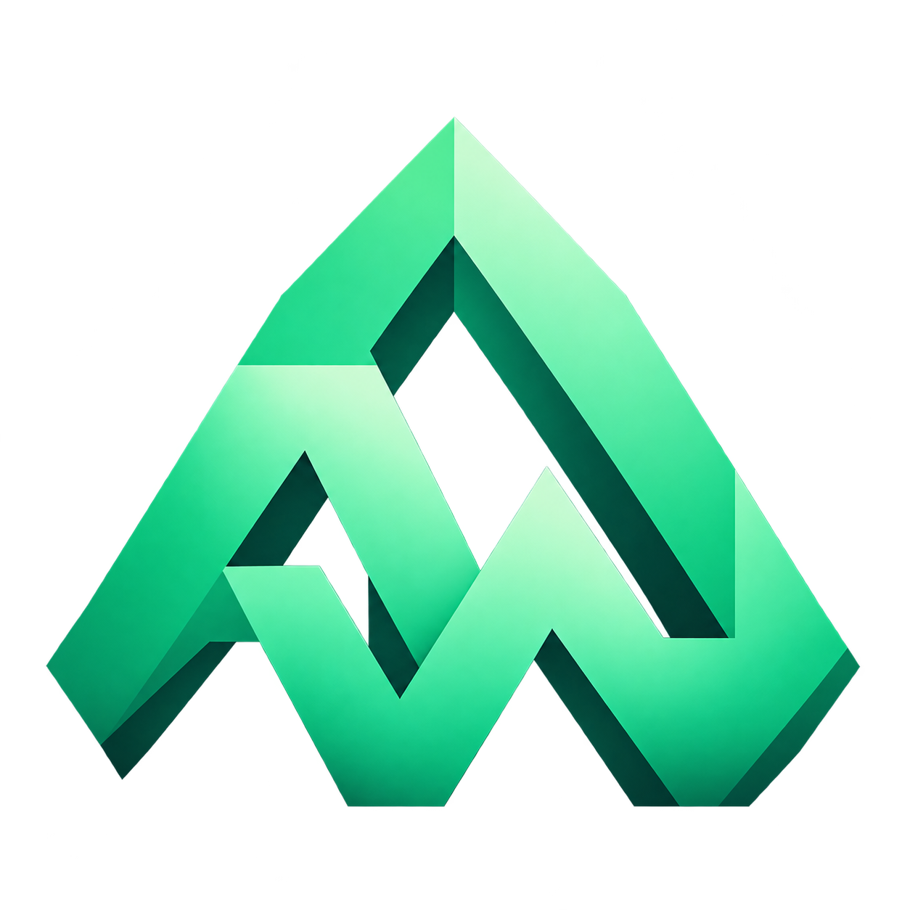

<div align="center">
  
  <h1>AWLauncher</h1>
  <p>Лаунчер Minecraft Java Edition с открытым исходным кодом</p>
  <p>Сборки, моды и аккаунты — в одном месте</p>
  <p>
    <a href="https://github.com/AlpheusWorld/AWLauncher-releases/releases/latest"><strong>Скачать для Windows</strong></a>
    · <a href="https://github.com/AlpheusWorld/AWLauncher-releases/releases/latest/download/AWLauncher-linux-x64.deb">Linux DEB</a>
    · <a href="https://github.com/AlpheusWorld/AWLauncher-releases/releases/latest/download/AWLauncher-linux-x64.rpm">Linux RPM</a>
    · <a href="https://awlauncher.ru">Сайт</a>
    · <a href="https://github.com/AlpheusWorld/AWLauncher-releases/issues">Сообщить об ошибке</a>
  </p>
  <p>
    <a href="https://github.com/AlpheusWorld/AWLauncher-releases/releases/latest"></a>
    <a href="LICENSE"></a>
    
  </p>
</div>

## Что умеет лаунчер

| Раздел | Возможности |
| --- | --- |
| **Сборки** | Отдельные профили со своими мирами, модами и настройками. Группы, избранное, собственные иконки и копирование сборок |
| **Minecraft** | Релизы, снапшоты и старые версии. Fabric, Forge, NeoForge и Quilt. Автоматический подбор Java |
| **Каталоги** | Поиск и установка модов, модпаков, датапаков, ресурспаков и шейдеров с Modrinth и CurseForge |
| **Перенос** | Импорт архивов `.mrpack` и CurseForge `.zip`, а также профилей из Modrinth App, Prism, MultiMC и других лаунчеров |
| **Аккаунты** | Вход через Microsoft, переключение аккаунтов, библиотека скинов и выбор доступных аккаунту плащей |
| **Загрузки** | Очередь задач с прогрессом, скоростью, отменой и повтором после ошибки |
| **Всё под рукой** | Скриншоты внутри лаунчера, история запусков, время игры, журналы и подсказки при вылетах |
| **Настройка** | Темы оформления, языки, параметры памяти и запуска для каждой сборки, Discord Rich Presence |

CurseForge доступен без ручной настройки API-ключа. Если автор проекта ограничил загрузку через сторонние приложения, лаунчер показывает, что файл недоступен.

## Игра с друзьями

В 1.0.31 добавлена вкладка «Друзья». Скопируй свой код, отправь его другу и подтверди заявку. Затем запусти сборку с поддерживаемым загрузчиком, открой свой мир через Esc → «Открыть для сети» и пригласи друга из лаунчера. Он получит уведомление, выберет сборку и нажмёт «Присоединиться». При отличающемся составе модов лаунчер попросит подтверждение; одинаковая версия Minecraft и загрузчик подбираются до запуска.

Функция по умолчанию включена и отключается в общих настройках. e4mc и его обязательные зависимости устанавливаются автоматически из Modrinth с проверкой контрольных сумм; поддержка конкретной версии и загрузчика определяется опубликованными выпусками мода. В Vanilla сетевой мод не добавляется. Если мод установил AWLauncher, выключатель отключает его на следующем запуске; вручную добавленные копии не удаляются.

Мир остаётся на компьютере хозяина. e4mc использует прямое P2P-подключение, когда это возможно, и свою инфраструктуру ретрансляции при необходимости. Отдельный игровой сервер, VPN-клиент и ручная настройка портов не нужны. Сервис AWLauncher передаёт только заявки, статусы и приглашения; Microsoft-токены и файлы миров ему не передаются. Доступ прекращается при закрытии мира или выполнении `/e4mc stop`. Приглашённый получает адрес мира, поэтому его нельзя считать закрытым ACL-доступом только для определённого аккаунта.

Код сервиса и описание протокола находятся в [friends-service](friends-service/README.md).

## Начать играть

1. Скачай **AWLauncher-Setup.exe** со [страницы последнего релиза](https://github.com/AlpheusWorld/AWLauncher-releases/releases/latest) и установи лаунчер
2. Открой **Аккаунты** и войди через Microsoft
3. Создай сборку с нужной версией Minecraft и загрузчиком или установи готовый модпак из каталога
4. Нажми **Играть**

Нужна **Windows 10 или 11, 64-бит**. Java для самого лаунчера входит в установщик, а игровую Java он подбирает и скачивает автоматически. Для официального входа нужен аккаунт с Minecraft Java Edition. Офлайн-профили доступны для игры без авторизации на серверах, которые её не требуют.

## Linux

Для Linux x64 доступны пакеты **DEB** и **RPM** на [странице последнего релиза](https://github.com/AlpheusWorld/AWLauncher-releases/releases/latest). Java для лаунчера включена в пакет.

Ubuntu / Debian:

```sh
sudo apt install ./AWLauncher-linux-x64.deb
```

Fedora / совместимые RPM-дистрибутивы:

```sh
sudo dnf install ./AWLauncher-linux-x64.rpm
```

Нужна графическая сессия X11 или XWayland. Для сохранения Microsoft-входа используется системная связка ключей Secret Service. Установщик добавляет необходимые зависимости. Лаунчер появится в меню приложений; данные и сборки хранятся в `~/.aw`.

Автообновления DEB и RPM используют отдельные подписанные файлы. Установка обновления запрашивает системное подтверждение через Polkit.

## Обновления

Лаунчер сам проверяет новые выпуски. Проверку также можно запустить в настройках, в разделе **О лаунчере**. Перед установкой проверяются подпись описания обновления, размер и контрольная сумма файла. Обновление сохраняет игровые профили и настройки.

Если установленная версия не поддерживает текущие автообновления, скачай свежий установщик со страницы релизов.

У существующей сборки можно **изменить версию Minecraft**: лаунчер ищет совместимые выпуски модов на Modrinth и CurseForge и предлагает оставить или отключить моды, для которых подходящий выпуск не найден. Обновление применяется в той же папке; прежние моды и настройки сохраняются в `aw-migration-backups`. Миры и конфиги остаются на месте.

## История изменений сборки

Во вкладке «История» внутри сборки доступны состояния перед обновлениями контента, обновлениями сборок и массовыми изменениями. История показывает прежние и новые версии проектов и объём снимков. «Вернуть рабочее состояние» восстанавливает последний снимок; можно выбрать более ранний, сохранить состояние вручную или удалить ненужные снимки. Перед восстановлением текущее состояние сохраняется отдельно, чтобы можно было отменить откат. Файлы находятся в `aw-build-history` внутри папки сборки.

Миры по умолчанию не копируются. Опция «Сохранять миры в новых снимках» включает их в следующие снимки; восстановление прогресса миров выбирается отдельно при откате. Без этой опции текущий прогресс миров сохраняется, а датапаки возвращаются к состоянию снимка. Снимки также сохраняют моды, настройки, скрипты, ресурспаки и шейдеры; журналы, скриншоты и кэш игровых файлов не копируются.

## Зависимости модов

При установке, обновлении и включении распознанного мода из Modrinth или CurseForge лаунчер подбирает обязательные зависимости для выбранных Minecraft и загрузчика. Подходящий выключенный мод включается, неподходящий выпуск заменяется совместимым. Конкретные выпуски, указанные автором, сохраняются. Новые файлы сначала подготавливаются отдельно; ошибка или отмена до применения не заменяет прежние моды. История сборки сохраняет состояние для отката. Та же проверка используется при автоматическом исправлении конфликтов.

Для Fabric проверяются требования из самих JAR, диапазоны версий, альтернативные ID и встроенные библиотеки. Новая зависимость не должна нарушать требования уже установленных Fabric-модов. При добавлении локальных JAR сначала выполняется распознавание по хешам. Если мод не распознан, доступна локальная проверка Fabric; для других неподдерживаемых описаний лаунчер предлагает установку через каталог. Отсутствующий проект нельзя надёжно найти по внутреннему ID мода, поэтому при неизвестной обязательной зависимости показывается её ID и требуемая версия.

Дополнительные моды не скачиваются автоматически. Открой выпуск проекта: в разделе «Дополнительные моды» можно перейти на их страницы и самостоятельно выбрать установку. Форматы метаданных описаны в документации [Fabric](https://docs.fabricmc.net/develop/loader/fabric-mod-json) и [CurseForge](https://docs.curseforge.com/rest-api/).

## Открытый проект

В этом репозитории находятся исходники и публичные релизы AWLauncher. Можно изучать код, собирать свою версию и предлагать изменения через pull request.

Для разработки нужны **Git и JDK 21**. Gradle Wrapper уже включён в проект:

```powershell
git clone https://github.com/AlpheusWorld/AWLauncher-releases.git
cd AWLauncher-releases
# JAVA_HOME должен указывать на установленный JDK 21
./gradlew.bat test -PnoDeploy
./gradlew.bat run -PnoDeploy
```

`-PnoDeploy` позволяет проверять проект без замены установленного лаунчера. Перед началом работы обнови `main` и создай отдельную ветку.

## Связь

- **Ошибки и предложения:** [GitHub Issues](https://github.com/AlpheusWorld/AWLauncher-releases/issues)
- **Изменения в выпусках:** [Releases](https://github.com/AlpheusWorld/AWLauncher-releases/releases)
- **Контакт проекта:** [contact@awlauncher.ru](mailto:contact@awlauncher.ru)

При сообщении об ошибке укажи версию лаунчера, версию Minecraft, загрузчик и шаги воспроизведения. Перед публикацией журнала убери личные данные и токены.

## Лицензия

Код AWLauncher распространяется по [MIT](LICENSE). Сторонние библиотеки, шрифты и ресурсы сохраняют свои лицензии; сведения о них находятся в [APPLICATION_LICENSE.md](APPLICATION_LICENSE.md).

AWLauncher — независимый проект, не связанный с Mojang или Microsoft и не одобренный ими. Minecraft и другие товарные знаки принадлежат их правообладателям.

## Контрибьюторы

Список контрибьюторов находится в [CONTRIBUTORS.md](CONTRIBUTORS.md).
